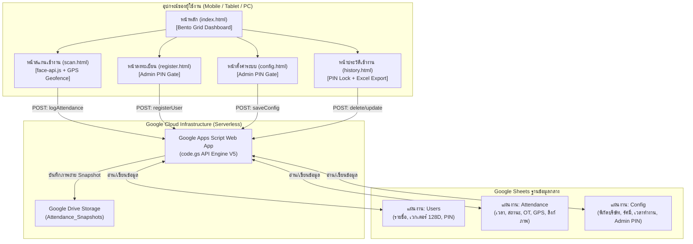
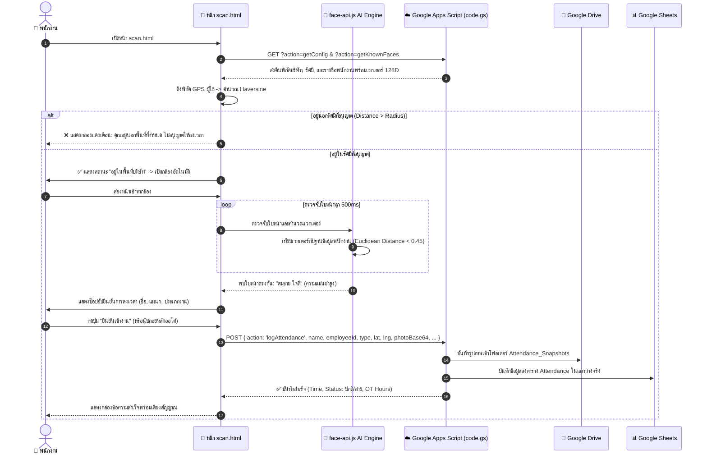

# ระบบบันทึกเวลาเข้างานอัจฉริยะ (Smart Attendance System v5.0)
## คู่มือปฏิบัติการ สถาปัตยกรรม และการบริหารจัดการระบบ (ฉบับสมบูรณ์)
**Face Recognition · GPS Geofencing · PWA Mobile-First · Google Apps Script & Sheets Database · OT Engine**

---

| ข้อมูลเอกสาร | รายละเอียด |
| :--- | :--- |
| **รหัสเอกสาร** | `QS-MANUAL-ATTENDANCE-2026-PROD` |
| **เวอร์ชัน** | Version 5.0 Production (Enterprise Grade) |
| **วันที่ประกาศใช้** | 10 พฤศจิกายน 2026 |
| **ระดับความลับ** | เอกสารควบคุมภายใน (Internal Confidential / IT Restricted) |
| **หน่วยงานที่รับผิดชอบ** | ฝ่ายพัฒนาระบบและเทคโนโลยีสารสนเทศ (IT Development Team) |
| **ระบบที่ครอบคลุม** | PWA Frontend (HTML5/CSS3/Vanilla JS), AI Face Recognition (face-api.js), Google Apps Script Backend (code.gs), Google Sheets Database, Google Drive Photo Vault, และ Node.js Local Testing Server |

---

## บันทึกประวัติการปรับปรุงระบบ (Revision History)

| เวอร์ชัน | วันที่ | รายละเอียดการปรับปรุง | ผู้รับผิดชอบ |
| :---: | :---: | :--- | :--- |
| **v5.0** | 10 พ.ย. 2026 | • ยกระดับระบบความปลอดภัย 2 ชั้น: รหัส PIN 4 หลักประจำตัวพนักงาน และ Admin PIN Gate ป้องกันการเข้าถึงโดยไม่ได้รับอนุญาต<br>• พัฒนาระบบส่งภาพถ่ายใบหน้าขณะสแกน (Photo Snapshot) จัดเก็บลง Google Drive โฟลเดอร์ `Attendance_Snapshots` อัตโนมัติ<br>• ปรับปรุงเอนจินคำนวณเวลาทำงานล่วงเวลา (OT Engine) และตรวจสถานะ มาสาย / ตรงเวลา อัตโนมัติ<br>• เพิ่มระบบ Export รายงานประวัติเข้างานเป็นไฟล์ Excel (`.xlsx`) แท้ผ่าน SheetJS<br>• พัฒนาระบบทำความสะอาดชีตอัตโนมัติ: ลบแถวว่าง (Clean Empty Rows) และล้างข้อมูลทดสอบ (Clean Mockup Data)<br>• บรรจุสถาปัตยกรรม PWA รองรับการติดตั้งแบบ Add to Home Screen และ Local Node.js Dev Server | IT Development Team (NICE) |

---

## สารบัญ (Table of Contents)

- [หมวดที่ 1: ภาพรวมระบบและฟีเจอร์เด่น (System Overview & Key Features)](#หมวดที่-1-ภาพรวมระบบและฟีเจอร์เด่น-system-overview--key-features)
  - [1.1 วัตถุประสงค์และประโยชน์ของระบบ](#11-วัตถุประสงค์และประโยชน์ของระบบ)
  - [1.2 ตารางสรุปฟีเจอร์หลัก 8 ประการ](#12-ตารางสรุปฟีเจอร์หลัก-8-ประการ)
  - [1.3 โครงสร้างเทคโนโลยี (Tech Stack Architecture)](#13-โครงสร้างเทคโนโลยี-tech-stack-architecture)
- [หมวดที่ 2: สถาปัตยกรรมระบบและการไหลของข้อมูล (System Architecture & Data Flow)](#หมวดที่-2-สถาปัตยกรรมระบบและการไหลของข้อมูล-system-architecture--data-flow)
  - [2.1 ผังการทำงานภาพรวม (Architecture Diagram)](#21-ผังการทำงานภาพรวม-architecture-diagram)
  - [2.2 ลำดับการทำงานขณะสแกนลงเวลา (Sequence Diagram)](#22-ลำดับการทำงานขณะสแกนลงเวลา-sequence-diagram)
  - [2.3 โครงสร้างฐานข้อมูล Google Sheets 3 แผ่นงาน](#23-โครงสร้างฐานข้อมูล-google-sheets-3-แผ่นงาน)
- [หมวดที่ 3: คู่มือการใช้งานสำหรับพนักงานทั่วไป (Staff User Guide)](#หมวดที่-3-คู่มือการใช้งานสำหรับพนักงานทั่วไป-staff-user-guide)
  - [3.1 การติดตั้งแอปพลิเคชันลงบนหน้าจอมือถือ (PWA Installation)](#31-การติดตั้งแอปพลิเคชันลงบนหน้าจอมือถือ-pwa-installation)
  - [3.2 ขั้นตอนการสแกนใบหน้าเข้า-ออกงาน (Scan Attendance)](#32-ขั้นตอนการสแกนใบหน้าเข้า-ออกงาน-scan-attendance)
  - [3.3 การตรวจสอบประวัติการลงเวลาส่วนบุคคลด้วยรหัส PIN](#33-การตรวจสอบประวัติการลงเวลาส่วนบุคคลด้วยรหัส-pin)
- [หมวดที่ 4: คู่มือสำหรับฝ่ายบุคคลและผู้ดูแลระบบ (HR & Admin SOP)](#หมวดที่-4-คู่มือสำหรับฝ่ายบุคคลและผู้ดูแลระบบ-hr--admin-sop)
  - [4.1 การเข้าสู่ระบบด้วย Admin PIN](#41-การเข้าสู่ระบบด้วย-admin-pin)
  - [4.2 การลงทะเบียนพนักงานและบันทึกใบหน้าใหม่ (register.html)](#42-การลงทะเบียนพนักงานและบันทึกใบหน้าใหม่-registerhtml)
  - [4.3 การตั้งค่าพิกัด GPS รัศมี และเวลางาน (config.html)](#43-การตั้งค่าพิกัด-gps-รัศมี-และเวลางาน-confightml)
  - [4.4 การตรวจสอบรายงาน คัดกรอง และดูรูปถ่ายหลักฐาน (history.html)](#44-การตรวจสอบรายงาน-คัดกรอง-และดูรูปถ่ายหลักฐาน-historyhtml)
  - [4.5 การแก้ไขและลบรายการลงเวลา (Edit/Delete Attendance)](#45-การแก้ไขและลบรายการลงเวลา-editdelete-attendance)
  - [4.6 การส่งออกรายงานเป็นไฟล์ Excel (.xlsx)](#46-การส่งออกรายงานเป็นไฟล์-excel-xlsx)
  - [4.7 เครื่องมือทำความสะอาดฐานข้อมูล (Database Housekeeping)](#47-เครื่องมือทำความสะอาดฐานข้อมูล-database-housekeeping)
- [หมวดที่ 5: สถาปัตยกรรมเทคนิคและ API Reference (Developer Deep-Dive)](#หมวดที่-5-สถาปัตยกรรมเทคนิคและ-api-reference-developer-deep-dive)
  - [5.1 กลไก AI Face Recognition (SSD MobileNet + 128D FaceNet)](#51-กลไก-ai-face-recognition-ssd-mobilenet--128d-facenet)
  - [5.2 สูตรคำนวณระยะพิกัด GPS (Haversine Formula)](#52-สูตรคำนวณระยะพิกัด-gps-haversine-formula)
  - [5.3 รายละเอียด API Endpoints ของ Google Apps Script (code.gs)](#53-รายละเอียด-api-endpoints-ของ-google-apps-script-codegs)
  - [5.4 การทำงานของ PWA Service Worker (sw.js)](#54-การทำงานของ-pwa-service-worker-swjs)
  - [5.5 การรันเซิร์ฟเวอร์จำลองในเครื่อง (Local Node.js Server server.cjs)](#55-การรันเซิร์ฟเวอร์จำลองในเครื่อง-local-nodejs-server-servercjs)
- [หมวดที่ 6: ขั้นตอนการติดตั้งและการนำขึ้นระบบ (Installation & Deployment Runbook)](#หมวดที่-6-ขั้นตอนการติดตั้งและการนำขึ้นระบบ-installation--deployment-runbook)
  - [6.1 การ Deploy Google Apps Script Web App](#61-การ-deploy-google-apps-script-web-app)
  - [6.2 การกำหนดค่า Web App URL ใน api-config.js](#62-การกำหนดค่า-web-app-url-ใน-api-configjs)
  - [6.3 การ Deploy Frontend ขึ้น Netlify](#63-การ-deploy-frontend-ขึ้น-netlify)
- [หมวดที่ 7: การแก้ไขปัญหาและคำถามที่พบบ่อย (Troubleshooting & FAQ)](#หมวดที่-7-การแก้ไขปัญหาและคำถามที่พบบ่อย-troubleshooting--faq)

---

## หมวดที่ 1: ภาพรวมระบบและฟีเจอร์เด่น (System Overview & Key Features)

### 1.1 วัตถุประสงค์และประโยชน์ของระบบ
ระบบ **Smart Attendance v5.0** ได้รับการออกแบบและพัฒนาขึ้นเพื่อแก้ปัญหาการลงเวลาทำงานแบบเดิม (เช่น การสแกนนิ้วมือที่ต้องสัมผัสร่วมกัน, การตอกบัตรที่ฝากกันตอกได้, หรือเครื่องสแกนราคาแพงที่เชื่อมต่อข้อมูลยาก):
1. **ป้องกันการลงเวลาแทนกัน 100% (Zero Proxy Punch):** ใช้โมเดลปัญญาประดิษฐ์ตรวจจับและสกัดเวกเตอร์โครงสร้างใบหน้า 128 มิติ พร้อมบันทึกภาพถ่าย Snapshot เข้าสู่ระบบ Google Drive ทันที
2. **ป้องกันการเช็คอินนอกสถานที่ (Zero GPS Spoofing):** ระบบตรวจสอบพิกัด Geolocation ด้วยสูตร Haversine หากอยู่นอกรัศมีที่บริษัทกำหนด (Allowed Radius) ระบบจะล็อกไม่ให้สแกน
3. **โครงสร้าง Serverless ไร้ค่าใช้จ่ายเซิร์ฟเวอร์ (Zero Hosting Cost):** ใช้งาน Frontend Static บน Netlify คู่กับ Backend Google Apps Script และฐานข้อมูล Google Sheets ไม่ต้องเช่า Cloud Server รายเดือน
4. **ความปลอดภัยของข้อมูลส่วนบุคคล (Privacy & Access Control):** พนักงานแต่ละคนมีรหัส PIN 4 หลักเพื่อเข้าดูประวัติเฉพาะตนเอง ส่วนฝ่ายบุคคลมี Admin PIN เพื่อเข้าถึงเมนูลงทะเบียนและแก้ไขข้อมูล

---

### 1.2 ตารางสรุปฟีเจอร์หลัก 8 ประการ

| ลำดับ | ฟีเจอร์หลัก | รายละเอียดความสามารถ | ประโยชน์ต่อองค์กร |
| :---: | :--- | :--- | :--- |
| **1** | **Face Recognition AI** | ใช้โมเดล SSD MobileNetV1 ตรวจจับตำแหน่งใบหน้า และ FaceNet สกัดเวกเตอร์ 128D (Threshold 0.45) | ระบุตัวตนได้แม่นยำภายใน 500ms ป้องกันการทุจริต |
| **2** | **GPS Geofencing** | ตรวจสอบพิกัดละติจูด/ลองจิจูดของผู้ใช้งานเทียบกับจุดพิกัดบริษัทแบบเรียลไทม์ | บังคับให้พนักงานต้องอยู่ในพื้นที่บริษัทจริงเท่านั้น |
| **3** | **PWA Mobile-First** | รองรับ Progressive Web App ติดตั้งเป็นไอคอนบนมือถือได้ทั้ง iOS และ Android | ใช้งานสะดวกเหมือนแอปพลิเคชันจริง ไม่ต้องโหลดผ่านสโตร์ |
| **4** | **Google Drive Vault** | แปลงภาพใบหน้าขณะสแกนเป็นไฟล์ JPEG อัปโหลดเข้าโฟลเดอร์ `Attendance_Snapshots` | มีหลักฐานภาพถ่ายยืนยันทุกครั้งที่เข้างาน |
| **5** | **OT & Shift Engine** | คำนวณสถานะ "ตรงเวลา", "มาสาย" และนับชั่วโมงการทำงานล่วงเวลา (OT) อัตโนมัติ | ลดภาระงานคำนวณเวลาของฝ่ายบุคคล (HR) |
| **6** | **Genuine Excel Export** | ฝังไลบรารี SheetJS ส่งออกประวัติเข้างานเป็นไฟล์ `.xlsx` แท้พร้อมฟอร์แมตวันที่ | สามารถนำข้อมูลไปประมวลผลต่อใน Excel / Payroll ได้ทันที |
| **7** | **PIN Gate Security** | ระบบล็อกหน้าประวัติด้วย PIN พนักงาน 4 หลัก และล็อกหน้า Admin ด้วยรหัสผ่าน Admin | รักษาความลับข้อมูลเงินเดือนและเวลาทำงานตามกฎหมาย PDPA |
| **8** | **Auto Data Hygiene** | ฟังก์ชัน `cleanEmptyRows` และ `cleanMockupData` ทำความสะอาดชีตอัตโนมัติ | ป้องกันตารางกระโดดข้ามแถวและลบข้อมูลขยะอัตโนมัติ |

---

### 1.3 โครงสร้างเทคโนโลยี (Tech Stack Architecture)

```
[Client / Mobile Browser]
       │
       ├── Progressive Web App (PWA) + Service Worker (sw.js)
       ├── UI: HTML5, CSS3 Glassmorphism, Google Sarabun Font
       ├── AI: face-api.js v0.22.2 (TensorFlow.js WebAssembly / WebGL)
       ├── Location: W3C Geolocation API (Haversine Distance Check)
       └── Export: SheetJS v0.18.5 (.xlsx Full Engine)
       │
       ▼ (HTTPS REST / JSON API)
[Google Apps Script Web App - code.gs V5]
       │
       ├── doGet(e)  : getConfig, getKnownFaces, getAttendance, cleanEmptyRows
       └── doPost(e) : registerUser, logAttendance, saveConfig, deleteAttendance, updateAttendance
       │
       ├───▶ [Google Sheets Database] : Users, Attendance, Config
       └───▶ [Google Drive Storage]   : Attendance_Snapshots/ (รูปถ่ายหลักฐาน)
```

---

## หมวดที่ 2: สถาปัตยกรรมระบบและการไหลของข้อมูล (System Architecture & Data Flow)

### 2.1 ผังการทำงานภาพรวม (Architecture Diagram)



---

### 2.2 ลำดับการทำงานขณะสแกนลงเวลา (Sequence Diagram)



---

### 2.3 โครงสร้างฐานข้อมูล Google Sheets 3 แผ่นงาน

#### 1. แผ่นงาน `Users` (ข้อมูลพนักงานและเวกเตอร์ใบหน้า)
| คอลัมน์ | ชื่อฟิลด์ | ชนิดข้อมูล | ตัวอย่างข้อมูล | คำอธิบาย |
| :---: | :--- | :---: | :--- | :--- |
| **A** | `Emp ID` | String | `EMP001` | รหัสประจำตัวพนักงาน |
| **B** | `Name` | String | `สมชาย ใจดี` | ชื่อ-นามสกุลพนักงาน |
| **C** | `Department` | String | `ฝ่ายขายและการตลาด` | แผนกหรือฝ่ายที่สังกัด |
| **D** | `Role` | String | `พนักงานทั่วไป` / `ผู้ดูแลระบบ` | ระดับสิทธิ์การเข้าถึง |
| **E** | `PIN` | String | `'1234` | รหัส PIN 4 หลักสำหรับดูประวัติส่วนตัว |
| **F** | `Face Descriptor` | JSON Array | `[-0.124, 0.089, ... 128 ตัว]` | เวกเตอร์โครงสร้างใบหน้า 128 มิติ |
| **G** | `Registered At` | Datetime | `2026-11-10 08:30:00` | วันเวลาที่ลงทะเบียน |

#### 2. แผ่นงาน `Attendance` (ประวัติการลงเวลาเข้า-ออกงาน)
| คอลัมน์ | ชื่อฟิลด์ | ชนิดข้อมูล | ตัวอย่างข้อมูล | คำอธิบาย |
| :---: | :--- | :---: | :--- | :--- |
| **A** | `Emp ID` | String | `EMP001` | รหัสพนักงานที่สแกน |
| **B** | `Name` | String | `สมชาย ใจดี` | ชื่อพนักงาน |
| **C** | `Department` | String | `ฝ่ายขายและการตลาด` | แผนก |
| **D** | `Type` | String | `เข้างาน (Check-In)` / `ออกงาน` / `เริ่ม OT` | ประเภทของการลงเวลา |
| **E** | `Time` | Time | `08:25:10` | เวลาที่บันทึก (ชั่วโมง:นาที:วินาที) |
| **F** | `Date` | Date | `10/11/2026` | วันที่บันทึก (วัน/เดือน/ปี) |
| **G** | `Status` | String | `ปกติ` / `สาย (Late)` | สถานะการเข้างานเทียบกับเวลาเริ่มงาน |
| **H** | `OT Hours` | Number | `2.5` | จำนวนชั่วโมงทำงานล่วงเวลา |
| **I** | `Latitude` | Number | `13.756300` | พิกัดละติจูดขณะสแกน |
| **J** | `Longitude` | Number | `100.501800` | พิกัดลองจิจูดขณะสแกน |
| **K** | `Google Map Link` | URL | `https://www.google.com/maps?q=13.75,100.50` | ลิงก์เปิดแผนที่พิกัดจริงบน Google Maps |
| **L** | `Photo Link` | URL | `https://drive.google.com/file/d/...` | ลิงก์เปิดดูภาพถ่ายใบหน้าขณะสแกน |

#### 3. แผ่นงาน `Config` (การตั้งค่าระบบ)
| พารามิเตอร์ (Col A) | ค่าที่ตั้ง (Col B) | ค่าเริ่มต้น | คำอธิบาย |
| :--- | :---: | :---: | :--- |
| `Target Latitude` | `13.756300` | พิกัดออฟฟิศ | ละติจูดจุดเช็คอินของบริษัท |
| `Target Longitude` | `100.501800` | พิกัดออฟฟิศ | ลองจิจูดจุดเช็คอินของบริษัท |
| `Allowed Radius (KM)` | `0.1` | `0.5` | รัศมีที่อนุญาต (0.1 = 100 เมตร, 0 = ปิดตรวจ GPS) |
| `Work Start Time` | `'08:30` | `08:30` | เวลาเริ่มงานปกติ (สแกนหลังเวลานี้จะขึ้นสถานะ "สาย") |
| `OT Start Time` | `'17:00` | `17:00` | เวลาเริ่มคิดโอทีสำหรับการออกงานช่วงค่ำ |
| `Admin PIN` | `'1234` | `1234` | รหัสผ่านสำหรับผู้ดูแลระบบเข้าหน้า Config/Register |

---

## หมวดที่ 3: คู่มือการใช้งานสำหรับพนักงานทั่วไป (Staff User Guide)

### 3.1 การติดตั้งแอปพลิเคชันลงบนหน้าจอมือถือ (PWA Installation)
เพื่อให้ใช้งานสะดวก รวดเร็ว และไม่ต้องพิมพ์ URL ซ้ำๆ พนักงานสามารถติดตั้งระบบเป็นแอปบนมือถือได้ทันที:

#### สำหรับ iPhone / iPad (iOS Safari):
1. เปิด Safari แล้วเข้าไปที่ URL ของระบบ (เช่น `https://your-site.netlify.app`)
2. กดปุ่ม **แชร์ (Share Icon)** รูปสี่เหลี่ยมมีลูกศรชี้ขึ้น ที่แถบด้านล่างของจอ
3. เลื่อนลงมาเลือกคำสั่ง **"เพิ่มไปยังหน้าจอโฮม (Add to Home Screen)"**
4. กดปุ่ม **"เพิ่ม (Add)"** ที่มุมบนขวา -> จะปรากฏไอคอน **"ลงเวลา"** บนหน้าจอมือถือเหมือนแอปพลิเคชันทั่วไป

#### สำหรับ Android (Google Chrome):
1. เปิด Google Chrome แล้วเข้าไปที่ URL ของระบบ
2. กดปุ่ม **จุด 3 จุด (⋮)** ที่มุมขวาบนของหน้าจอ
3. เลือกคำสั่ง **"ติดตั้งแอป (Install App)"** หรือ **"เพิ่มลงในหน้าจอหลัก"**
4. กดยืนยันการติดตั้ง -> ไอคอนแอปจะปรากฏบนหน้าจอหลักทันที

---

### 3.2 ขั้นตอนการสแกนใบหน้าเข้า-ออกงาน (Scan Attendance)
1. กดเปิดแอป **"ลงเวลา"** จากหน้าจอมือถือ -> จะเข้าสู่หน้าหลัก (`index.html`)
2. กดที่การ์ดขนาดใหญ่ด้านบน **"สแกนใบหน้าลงเวลา (Face Scan Attendance)"** เพื่อเข้าสู่หน้า `scan.html`
3. ระบบจะตรวจสอบตำแหน่ง GPS ของท่านโดยอัตโนมัติ:
   - หากขึ้นแถบสีเขียว **"อยู่ในพื้นที่บริษัท"** ระบบจะเปิดกล้องขึ้นมาทันที
   - หากขึ้นแถบสีแดง แสดงว่าท่านอยู่นอกพื้นที่ ให้ขยับเข้าใกล้จุดเช็คอินของบริษัท
4. เลือกประเภทการลงเวลาที่ต้องการ:
   - **เข้างาน (Check-In)** — สำหรับลงเวลาช่วงเช้า
   - **ออกงาน (Check-Out)** — สำหรับลงเวลาช่วงเลิกงาน
   - **เข้างาน OT / ออกงาน OT** — สำหรับการทำงานล่วงเวลา
5. ส่องใบหน้าให้ตรงกับกรอบสีเขียวบนหน้าจอ:
   - ถอดแว่นกันแดดหรือหน้ากากอนามัยชั่วคราว
   - อยู่ในที่ที่มีแสงสว่างเพียงพอ
6. เมื่อระบบตรวจจับพบใบหน้าตรงกัน จะปรากฏหน้าต่างยืนยัน:
   - ตรวจสอบชื่อ-นามสกุล และเวลา
   - กดปุ่ม **"ยืนยันเข้างาน"** หรือรอระบบนับถอยหลังอัตโนมัติ
7. เมื่อระบบขึ้นข้อความสีเขียว **"บันทึกสำเร็จ"** เป็นอันเสร็จสิ้นขั้นตอน

---

### 3.3 การตรวจสอบประวัติการลงเวลาส่วนบุคคลด้วยรหัส PIN
1. จากหน้าหลัก กดเลือกที่เมนู **"ประวัติบันทึกเวลา (Attendance History)"** (`history.html`)
2. ระบบจะแสดงหน้าต่างความปลอดภัย **"ส่วนตรวจสอบประวัติการลงเวลา"**
3. ให้พนักงานกรอก **"รหัส PIN 4 หลักประจำตัว"** ที่ได้รับตอนลงทะเบียน
4. ระบบจะกรองและแสดงผล **เฉพาะรายการลงเวลาของตัวพนักงานเองเท่านั้น** โดยไม่แสดงข้อมูลของผู้อื่น
5. พนักงานสามารถเลือกดูสรุปสถิติประจำเดือน: จำนวนครั้งที่เข้างาน, จำนวนครั้งที่มาสาย, และชั่วโมง OT รวม

---

## หมวดที่ 4: คู่มือสำหรับฝ่ายบุคคลและผู้ดูแลระบบ (HR & Admin SOP)

### 4.1 การเข้าสู่ระบบด้วย Admin PIN
เพื่อความมั่นคงปลอดภัยของข้อมูลองค์กร หน้าเมนูต่อไปนี้จะถูกล็อกด้วย **Admin PIN Gate**:
- หน้าลงทะเบียนพนักงาน (`register.html`)
- หน้าตั้งค่าระบบ (`config.html`)
- ปุ่มแก้ไข/ลบรายการในหน้าประวัติ (`history.html`)

> [!NOTE]
> รหัส Admin PIN เริ่มต้นจากโรงงานคือ **`1234`** ขอแนะนำให้ฝ่ายบุคคลหรือผู้ดูแลระบบเปลี่ยนเป็นรหัสเฉพาะของตนเองทันทีหลังติดตั้งระบบสำเร็จ

---

### 4.2 การลงทะเบียนพนักงานและบันทึกใบหน้าใหม่ (`register.html`)
เมื่อมีพนักงานใหม่เข้าทำงาน ให้ฝ่ายบุคคลดำเนินการลงทะเบียนตามขั้นตอนดังนี้:
1. เข้าไปที่หน้า **"ลงทะเบียนพนักงาน (Register)"** ผ่านหน้าหลัก
2. กรอกรหัส **Admin PIN** เพื่อปลดล็อกหน้าจอ
3. กรอกข้อมูลส่วนตัวของพนักงาน:
   - **รหัสพนักงาน (Emp ID):** เช่น `EMP001` (จำเป็นสำหรับอ้างอิงข้อมูล)
   - **รหัส PIN 4 หลักของพนักงาน:** กำหนดรหัส 4 ตัวเลข (เช่น `5678`) เพื่อให้พนักงานใช้เปิดดูประวัติตนเอง
   - **ระดับสิทธิ์ (Role):** เลือกเป็น `พนักงานทั่วไป (Staff)` หรือ `ผู้ดูแลระบบ (Admin)`
   - **แผนก / ฝ่าย:** เลือกแผนกที่พนักงานสังกัด
   - **ชื่อ-นามสกุล:** ระบุชื่อจริงและนามสกุลให้ชัดเจน
4. ให้พนักงานยืนหน้ากล้องในระยะ 40 – 60 ซม. ในบริเวณที่แสงสว่างทั่วใบหน้า
5. เมื่อระบบตรวจจับใบหน้าได้ ปุ่ม **"ถ่ายภาพและบันทึกใบหน้า"** จะเปลี่ยนเป็นสีน้ำเงินพร้อมใช้งาน
6. กดปุ่มบันทึก 1 ครั้ง -> ระบบจะสกัดเวกเตอร์ 128 มิติ และส่งข้อมูลไปบันทึกลงชีต `Users` ทันที

> [!TIP]
> หากต้องการความแม่นยำสูงขึ้น สามารถบันทึกใบหน้าพนักงานคนเดิมซ้ำอีก 1 ครั้งในมุมเอียงซ้ายหรือขวาเล็กน้อย เพื่อให้ระบบจดจำใบหน้าได้หลายมิติ

---

### 4.3 การตั้งค่าพิกัด GPS รัศมี และเวลางาน (`config.html`)
ฝ่ายบุคคลสามารถปรับแต่งพารามิเตอร์การทำงานของระบบได้ผ่านหน้า `config.html`:
1. กรอกรหัส **Admin PIN** เพื่อเข้าสู่หน้าตั้งค่า
2. **การตั้งค่าจุดเช็คอินบริษัท (GPS Geofence):**
   - หากท่านยืนอยู่ที่ออฟฟิศ ให้กดปุ่ม **"ดึงตำแหน่งปัจจุบัน (Get Current Location)"** ระบบจะดึงพิกัดจริงมาใส่ในช่อง Latitude/Longitude ทันที
   - กำหนด **รัศมีที่ยอมรับ (Allowed Radius):** แนะนำตั้งค่าที่ `0.1` (100 เมตร) หรือ `0.05` (50 เมตร) สำหรับตึกสำนักงาน
   - *หมายเหตุ:* หากต้องการปิดการตรวจสอบพิกัดชั่วคราว ให้ใส่ค่ารัศมีเป็น `0`
3. **การตั้งค่าเวลาทำงานและเกณฑ์คิดโอที:**
   - **เวลาเริ่มงานปกติ (Work Start Time):** เช่น `08:30` (พนักงานที่สแกนหลัง 08:30 จะถูกบันทึกสถานะเป็น "สาย")
   - **เวลาเริ่มงานล่วงเวลา (OT Start Time):** เช่น `17:00` (ระบบจะคำนวณชั่วโมง OT ตั้งแต่ 17:00 เป็นต้นไป)
4. **การเปลี่ยนรหัสผ่าน Admin PIN:**
   - กรอกรหัส 4 หลักใหม่ในช่อง Admin PIN
5. กดปุ่ม **"บันทึกการตั้งค่าทั้งหมด"** -> ข้อมูลจะถูกบันทึกขึ้นชีต `Config` ทันที

---

### 4.4 การตรวจสอบรายงาน คัดกรอง และดูรูปถ่ายหลักฐาน (`history.html`)
1. เข้าหน้า `history.html` และกรอก **Admin PIN** เพื่อดูข้อมูลพนักงานทุกคน
2. **การคัดกรองข้อมูล (Filter Tools):**
   - คัดกรองตาม **ช่วงวันที่ (Date Range)**
   - คัดกรองตาม **แผนก (Department)**
   - คัดกรองตาม **สถานะ (ปกติ / มาสาย / OT)**
   - ค้นหาด่วนด้วย **ชื่อพนักงาน หรือ รหัสพนักงาน**
3. **การตรวจสอบภาพถ่ายหลักฐาน (Photo Audit):**
   - ที่คอลัมน์รูปถ่าย ให้คลิกที่ไอคอน **"ดูรูปภาพ (View Photo)"**
   - ระบบจะเปิดรูปภาพ snapshot ที่บันทึกไว้ใน Google Drive ขึ้นมา เพื่อยืนยันว่าเป็นพนักงานตัวจริงสแกน ไม่ใช่การนำรูปถ่ายมาหลอกกล้อง
4. **การตรวจสอบพิกัดบนแผนที่:**
   - คลิกที่ลิงก์พิกัด ระบบจะเปิดแผนที่ **Google Maps** ระบุตำแหน่งจริงขณะสแกน

---

### 4.5 การแก้ไขและลบรายการลงเวลา (Edit/Delete Attendance)
กรณีพนักงานลืมสแกน หรือเกิดข้อผิดพลาดในการเลือกประเภทงาน ฝ่ายบุคคลที่มีสิทธิ์ Admin สามารถจัดการได้โดยตรง:
- **การแก้ไขเวลา/สถานะ:** คลิกปุ่ม **[แก้ไข]** ที่รายการ -> ปรับเปลี่ยนเวลา ประเภท หรือชั่วโมง OT -> กดยืนยัน ข้อมูลใน Google Sheets จะถูกอัปเดตแบบเรียลไทม์
- **การลบรายการ:** คลิกปุ่ม **[ลบ]** ที่รายการ -> ยืนยันการลบ ระบบจะตัดแถวนั้นออกจากชีต `Attendance` ทันที

---

### 4.6 การส่งออกรายงานเป็นไฟล์ Excel (`.xlsx`)
1. กรองข้อมูลช่วงวันที่หรือแผนกที่ต้องการในหน้า `history.html`
2. คลิกปุ่มสีเขียว **"ส่งออก Excel (.xlsx)"**
3. ระบบจะประมวลผลผ่านไลบรารี SheetJS และดาวน์โหลดไฟล์ชื่อ `Attendance_Report_YYYY-MM-DD.xlsx` ลงเครื่องทันที
4. ไฟล์ Excel มีหัวตารางครบถ้วน พร้อมนำเข้าโปรแกรมเงินเดือน (Payroll) หรือโปรแกรม Express Accounting ได้ทันที

---

### 4.7 เครื่องมือทำความสะอาดฐานข้อมูล (Database Housekeeping)
ในหน้า `config.html` และ `history.html` มีปุ่มเครื่องมือพิเศษสำหรับผู้ดูแลระบบ:
1. **ลบแถวว่างในชีต (Clean Empty Rows):** สแกนชีต `Attendance` หากมีแถวว่างที่เกิดจากการแทรกหรือลบผิดพลาด ระบบจะลบแถวว่างทิ้งทั้งหมด ทำให้ตารางชิดติดกัน ไม่เกิดปัญหาตารางกระโดด
2. **ล้างข้อมูลทดสอบ (Clean Mockup Data):** ลบข้อมูลจำลองหรือข้อมูลทดสอบระบบตั้งแต่ช่วงติดตั้ง คงเหลือไว้เฉพาะข้อมูลจริงที่พร้อมใช้งาน

---

## หมวดที่ 5: สถาปัตยกรรมเทคนิคและ API Reference (Developer Deep-Dive)

### 5.1 กลไก AI Face Recognition (SSD MobileNet + 128D FaceNet)
ระบบใช้ไลบรารี **face-api.js** ซึ่งทำงานบน TensorFlow.js ภายในเบราว์เซอร์ของผู้ใช้:
1. **SSD MobileNetV1:** ใช้ในการระบุพิกัดกรอบใบหน้า (Bounding Box) บนเฟรมภาพจากกล้อง
2. **Face Landmark 68 Points:** ตรวจจับตำแหน่งดวงตา คิ้ว จมูก ปาก เพื่อปรับองศาใบหน้าให้ตรง (Face Alignment)
3. **FaceNet (128-Dimensional Vector):** สกัดลักษณะเฉพาะทางชีวภาพของใบหน้าออกมาเป็นตัวเลขทศนิยม 128 ค่า
4. **Euclidean Distance Matching:** นำเวกเตอร์ที่ได้เทียบกับเวกเตอร์ในฐานข้อมูล:
   $$\text{Distance} = \sqrt{\sum_{i=1}^{128} (A_i - B_i)^2}$$
   - หากค่า Distance **น้อยกว่า 0.45 (`MATCH_THRESHOLD`)** ระบบจะตัดสินว่าเป็นบุคคลเดียวกัน

---

### 5.2 สูตรคำนวณระยะพิกัด GPS (Haversine Formula)
ระบบคำนวณระยะห่างระหว่างตำแหน่งปัจจุบันของผู้ใช้กับจุดพิกัดบริษัทด้วยสูตรตรีโกณมิติบนทรงกลมโลก:

$$d = 2R \cdot \arcsin\left(\sqrt{\sin^2\left(\frac{\Delta\text{lat}}{2}\right) + \cos(\text{lat}_1)\cos(\text{lat}_2)\sin^2\left(\frac{\Delta\text{lng}}{2}\right)}\right)$$

โดยที่ $R = 6,371\text{ กิโลเมตร}$ (รัศมีเฉลี่ยของโลก)  
หาก $d \le \text{Allowed Radius}$ ระบบจะอนุญาตให้สแกนเข้างาน

---

### 5.3 รายละเอียด API Endpoints ของ Google Apps Script (`code.gs`)

Web App URL Endpoint: `https://script.google.com/macros/s/[SCRIPT_ID]/exec`

#### 1. HTTP GET Methods
| Action | พารามิเตอร์ | Response | คำอธิบาย |
| :--- | :--- | :--- | :--- |
| `getConfig` | `?action=getConfig` | JSON Object config | ดึงค่าพิกัด, รัศมี, เวลางาน, และ Admin PIN |
| `getKnownFaces` | `?action=getKnownFaces` | JSON Array users | ดึงรายชื่อพนักงานและเวกเตอร์ใบหน้า 128 มิติ |
| `getAttendance` | `?action=getAttendance` | JSON Array logs | ดึงรายการประวัติเข้างานทั้งหมด เรียงจากล่าสุดไปอดีต |
| `cleanEmptyRows`| `?action=cleanEmptyRows` | `{ success: true, count: N }` | ลบแถวว่างในชีต Attendance |
| `cleanMockupData`| `?action=cleanMockupData` | `{ success: true }` | ลบข้อมูลจำลองที่ไม่ใช่เวกเตอร์ 128 มิติ |

#### 2. HTTP POST Methods
| Action | Payload (JSON Body) | Response | คำอธิบาย |
| :--- | :--- | :--- | :--- |
| `registerUser` | `{ action, employeeId, name, department, role, pin, faceDescriptor }` | `{ success: true }` | บันทึกพนักงานใหม่ลงชีต Users |
| `logAttendance` | `{ action, employeeId, name, department, type, lat, lng, photoBase64, status, otHours }` | `{ success: true, time, status }` | บันทึกประวัติเข้างานลงชีต Attendance และอัปโหลดภาพ |
| `saveConfig` | `{ action, lat, lng, radius, workStartTime, otStartTime, adminPin }` | `{ success: true }` | บันทึกการตั้งค่าลงชีต Config |
| `updateAttendance`| `{ action, employeeId, date, originalTime, newTime, newType, newStatus, newOtHours }` | `{ success: true }` | แก้ไขข้อมูลรายการลงเวลา |
| `deleteAttendance`| `{ action, employeeId, date, time }` | `{ success: true }` | ลบรายการลงเวลาที่ระบุ |

---

### 5.4 การทำงานของ PWA Service Worker (`sw.js`)
ไฟล์ `sw.js` ทำหน้าที่เป็นแคชเซิร์ฟเวอร์ในตัวเบราว์เซอร์:
- **Cache Name:** `facescan-v2-cache`
- **Cache Strategy:** Network-First with Fallback to Cache สำหรับไฟล์ UI หลัก (`index.html`, `scan.html`, `manifest.json`, ไอคอน)
- ทำให้ผู้ใช้งานสามารถเปิดหน้าจอแอปขึ้นมาได้ทันทีแม้สัญญาณอินเทอร์เน็ตจะติดขัดชั่วคราว

---

### 5.5 การรันเซิร์ฟเวอร์จำลองในเครื่อง (Local Node.js Server `server.cjs`)
สำหรับนักพัฒนาที่ต้องการทดสอบหรือแก้ไข UI โดยไม่ต้องต่อเน็ต:
1. ติดตั้ง Node.js ลงในเครื่อง
2. เปิด Terminal ในโฟลเดอร์โครงการ แล้วสั่งรัน:
   ```bash
   node server.cjs
   ```
3. เซิร์ฟเวอร์จะเปิดทำงานที่ `http://localhost:3008`
4. ข้อมูลจะถูกจำลองอ่าน-เขียนผ่านไฟล์ `local_db.json` เสมือนเป็น Google Sheets จริง

---

## หมวดที่ 6: ขั้นตอนการติดตั้งและการนำขึ้นระบบ (Installation & Deployment Runbook)

### 6.1 การ Deploy Google Apps Script Web App
1. สร้าง Google Sheets ใหม่ขึ้นมา 1 ไฟล์ ตั้งชื่อว่า `Smart_Attendance_DB`
2. ไปที่เมนู **ส่วนขยาย (Extensions) -> Apps Script**
3. ลบโค้ดเดิมออกทั้งหมด แล้วคัดลอกโค้ดจากไฟล์ `code.gs` ไปวาง
4. เลือกฟังก์ชัน `setupAndCreateSheets` แล้วกดปุ่ม **"เรียกใช้ (Run)"** 1 ครั้ง เพื่อสร้างหัวตารางทั้ง 3 ชีต
5. คลิกปุ่มสีน้ำเงิน **การทำให้ใช้งานได้ (Deploy) -> การทำให้ใช้งานได้ใหม่ (New deployment)**:
   - เลือกประเภท: **เว็บแอป (Web app)**
   - ดำเนินการในฐานะ (Execute as): **ฉัน (Me)**
   - ผู้มีสิทธิ์เข้าถึง (Who has access): **ทุกคน (Anyone)** *(สำคัญมาก เพื่อให้สแกนได้โดยไม่ต้องล็อกอินกูเกิล)*
6. กดปุ่ม **"ทำให้ใช้งานได้ (Deploy)"** และคัดลอก **Web App URL** ที่ลงท้ายด้วย `/exec`

---

### 6.2 การกำหนดค่า Web App URL ใน `api-config.js`
เปิดไฟล์ `js/api-config.js` แล้วนำ URL ที่ได้จากข้อ 6.1 มาวางแทนที่:
```javascript
const GAS_API_URL = 'https://script.google.com/macros/s/YOUR_ACTUAL_SCRIPT_ID/exec';
```

---

### 6.3 การ Deploy Frontend ขึ้น Netlify
เนื่องจากฟังก์ชันกล้องและ Geolocation บังคับให้ต้องทำงานผ่าน **HTTPS** เท่านั้น Netlify จึงเป็นตัวเลือกที่ดีที่สุด (ฟรีและมี HTTPS อัตโนมัติ):
1. เข้าไปที่ [app.netlify.com/drop](https://app.netlify.com/drop)
2. ลากโฟลเดอร์โครงการทั้งหมดไปวางในช่องอัปโหลด
3. รอระบบประมวลผลประมาณ 15 วินาที -> จะได้ URL ของระบบทันที เช่น `https://smart-attendance-qs.netlify.app`
4. นำ URL นี้ไปแจกจ่ายให้พนักงานใช้งานได้ทันที

---

## หมวดที่ 7: การแก้ไขปัญหาและคำถามที่พบบ่อย (Troubleshooting & FAQ)

| ปัญหาที่พบ | สาเหตุที่เป็นไปได้ | วิธีการแก้ไข |
| :--- | :--- | :--- |
| **กล้องไม่ยอมเปิด / จอดำ** | เบราว์เซอร์ยังไม่ได้รับอนุญาตให้เข้าถึงกล้อง หรือไม่ได้เข้าผ่าน HTTPS | • ตรวจสอบว่าเข้าด้วย URL ที่ขึ้นต้นด้วย `https://`<br>• กดที่ไอคอนรูปแม่กุญแจหน้า URL แล้วเลือก **"อนุญาตการใช้กล้อง (Allow Camera)"** |
| **ขึ้นแถบแดงเตือน "อยู่นอกพื้นที่"** | พิกัด GPS ผู้ใช้คลาดเคลื่อน หรืออยู่นอกรัศมี | • ตรวจสอบว่าเปิด Location Service ในมือถือแล้ว<br>• ให้ผู้ดูแลระบบเข้าหน้า `config.html` เพื่อขยายรัศมีเป็น `0.2` หรือ `0.5` กม. |
| **กล้องสแกนไม่ติด / ไม่ขึ้นชื่อ** | แสงสว่างไม่พอ หรือใบหน้าเอียงเกินไป | • ขยับเข้าหาบริเวณที่มีแสงสว่าง ส่องหน้าตรงกับกล้อง<br>• ให้ Admin ช่วยลงทะเบียนใบหน้าซ้ำในหน้า `register.html` อีกครั้ง |
| **ขึ้นข้อความ "เชื่อมต่อ API ไม่ได้"** | URL ของ Google Apps Script ไม่ถูกต้อง หรือยังไม่ได้เปิดเป็น Anyone | • ตรวจสอบไฟล์ `js/api-config.js`<br>• ตรวจสอบใน Apps Script ว่าสิทธิ์ Access ตั้งเป็น **Anyone** แล้วหรือไม่ |
| **หน้าจอบน iPhone ลอยเลื่อนตอนแตะ** | การตั้งค่า Viewport ซูมหน้าจอ | ในโค้ดได้ฝัง `viewport-fit=cover` และ `touch-action: manipulation` ไว้แล้ว ให้ติดตั้งแบบ Add to Home Screen จะใช้งานได้นิ่งสนิท |

---

<p align="center"><em>— สิ้นสุดเอกสารคู่มือปฏิบัติการ · ฝ่ายพัฒนาระบบเทคโนโลยีสารสนเทศ · QS Smart Development Team —</em></p>
